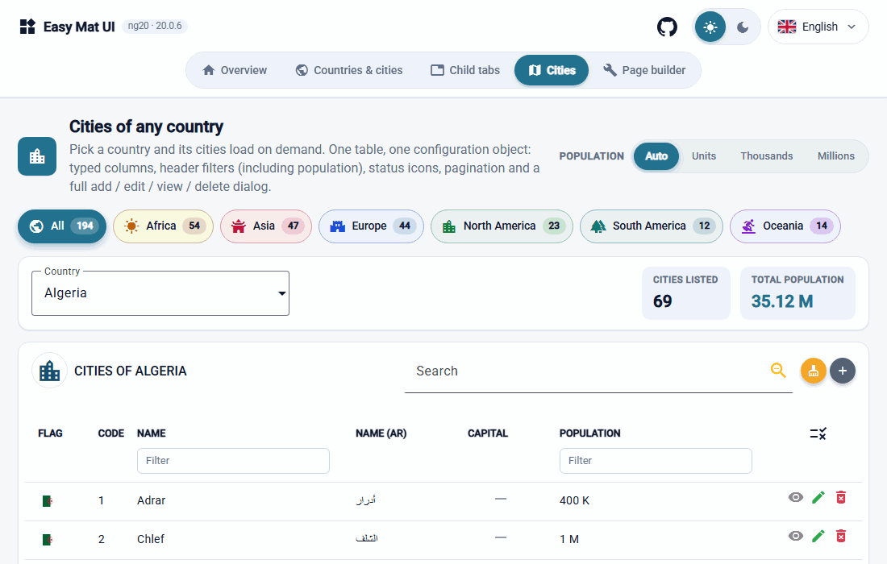
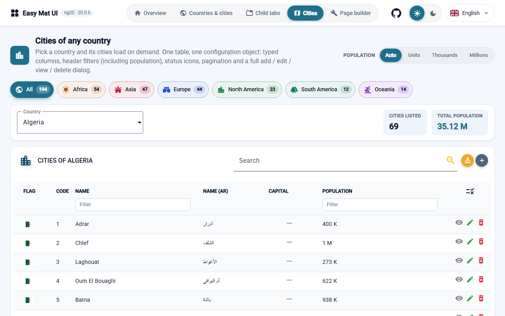
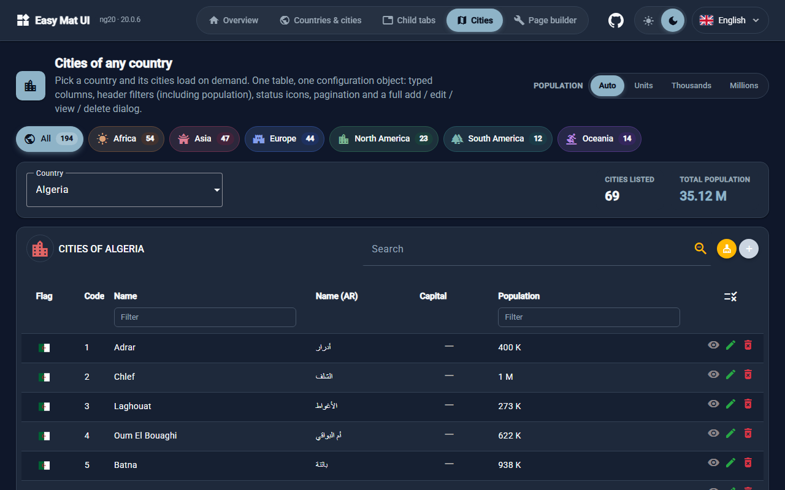
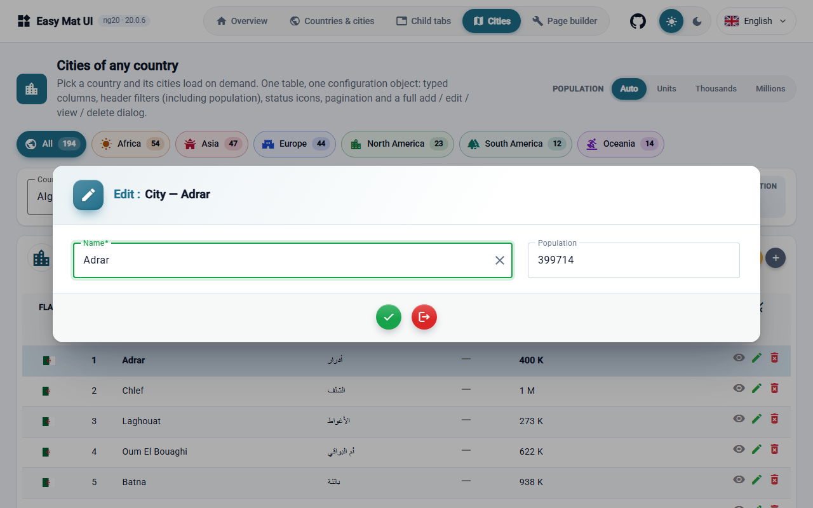
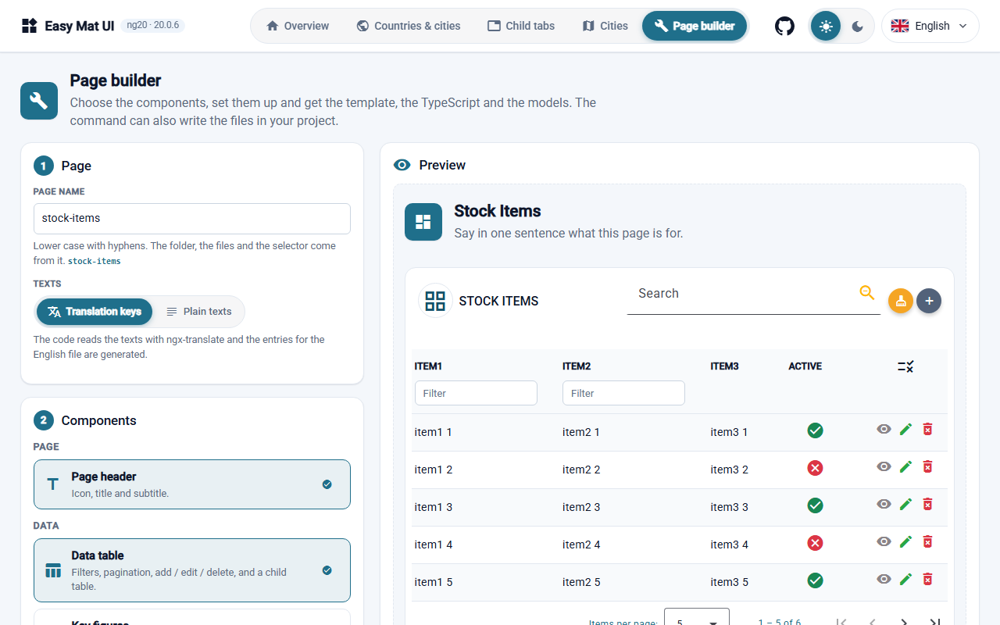

<div align="center">


**Data tables and reusable UI components for Angular Material.**

Describe a table in one configuration object: column filters, pagination, a create / edit / view dialog, child tables and light and dark themes.

[](https://www.npmjs.com/package/easy-mat-ui-ng20)
[](https://github.com/chaibiredouane/easy-mat-ui/actions/workflows/ci.yml)
[](https://angular.dev)
[](https://github.com/chaibiredouane/easy-mat-ui/blob/main/LICENSE)

**[Live demo](https://easy-mat-ui.web.app/)** · **[Try it on StackBlitz](https://stackblitz.com/github/chaibiredouane/easy-mat-ui/tree/main/examples/stackblitz-starter)** · **[Documentation](https://easy-mat-ui.web.app/docs/)** · [npm](https://www.npmjs.com/package/easy-mat-ui-ng20) · [Changelog](https://github.com/chaibiredouane/easy-mat-ui/blob/main/CHANGELOG.md)



</div>

> Angular Material gives you the building blocks. Easy Mat UI is a layer on top of it for the screens you rebuild in every project: a data table with its filters, pagination and edit dialog, described once.

A set of customizable Angular Material components built around a configurable **data table**:
filtering, sorting, pagination, typed columns, expandable rows, tabbed child tables, a toolbar,
a configurable **create / edit / view dialog** and a **multi-select** control, with
[ngx-translate](https://github.com/ngx-translate/core) based i18n.

## Features

- `lib-easy-table` / `lib-easy-table-basic`: a Material table driven by a single `EasyTableConfig` object.
- Typed columns (`MatColumnTyped`): text, number, date, date-time, icon, icon-and-text, button, dropdown list, image
  (flags), password and filter columns.
- **Column filters** under the titles (a compact text input or a multi-select per column), global search, sorting,
  pagination, sticky columns and a header that stays pinned while the rows scroll.
- Expandable rows with **child tables**, or several child tables in **tabs** (`childConfig`).
- `EasyDialogService`: a configurable dialog to create, edit or view a record.
- `lib-easy-multi-select`: a searchable multi-select with select-all, clear, read-only and compact modes, or a single-choice dropdown (`single`).
- Reusable interface components, each with `@Input()` / `@Output()` and a typed model: `lib-easy-segmented`,
  `lib-easy-chip-nav`, `lib-easy-language-switch`, `lib-easy-card` / `lib-easy-card-grid`, `lib-easy-stat` and
  `lib-easy-page-header`.
- **Page generation**: the *Page builder* of the demo and the `npx easy-mat-ui add-page` command generate a page from these components and a table (see [Generate a page](#generate-a-page)).
- **Light and dark themes** switchable at runtime (`EasyThemeService`), driven by CSS variables.
- Responsive layout (tables adapt below 768 px and 1024 px) and no WCAG 2 A/AA violation reported by axe-core on the demo.
- Shared models, enums and configuration classes exported from one entry point.

## Screenshots

Taken from the [live demo](https://easy-mat-ui.web.app/) (version 20.0.6), not mocked up.

| Light | Dark |
|---|---|
|  |  |
|  |  |

## Requirements and supported versions

This package targets **Angular 20**. Each Angular major version has its own package so that applications
are never forced to upgrade:

| Angular | Package | Library version |
|---|---|---|
| 20 | `easy-mat-ui-ng20` | `20.x.x` |
| 21 | `easy-mat-ui-ng21` | `21.x.x` (planned) |

Peer dependencies: `@angular/core`, `@angular/common`, `@angular/forms`, `@angular/cdk`,
`@angular/material`, `@angular/platform-browser` (all `^20.0.0`), `@ngx-translate/core` `^16`,
`bootstrap` `^5`, `rxjs` `^7`. Optional: `@ngx-translate/http-loader`, `flag-icons` (country columns).

## Status and limits

- **A young project.** The first release (20.0.0) is from 3 November 2026, and the library is maintained by one person. Feedback and [contributions](https://github.com/chaibiredouane/easy-mat-ui/blob/main/CONTRIBUTING.md) are welcome; security reports go through [SECURITY.md](https://github.com/chaibiredouane/easy-mat-ui/blob/main/SECURITY.md).
- **Angular 20.** There is one package per Angular major version (`easy-mat-ui-ng20`). `ng21` is planned, not released.
- **Data is handled in the browser.** There is no server-side paging and no virtual scrolling. For hundreds of thousands of rows, or spreadsheet-style editing, use a grid built for that, such as AG Grid or TanStack Table.
- **Click-to-sort is off when header filters are on** (`withFilterInHeader: true`). Use the global search, or leave the header filters off, if you need sorting.
- **Checked on every pull request:** the build, the unit tests, a compile check of the pages the generator writes and of the code examples of the documentation.

## Installation

Want to see it first? The [starter project on StackBlitz](https://stackblitz.com/github/chaibiredouane/easy-mat-ui/tree/main/examples/stackblitz-starter) runs in your browser, with nothing to install. Its source is in [`examples/stackblitz-starter`](https://github.com/chaibiredouane/easy-mat-ui/tree/main/examples/stackblitz-starter).

```bash
npm install easy-mat-ui-ng20
```

Install the peer dependencies if your project does not have them yet:

```bash
ng add @angular/material
npm install @ngx-translate/core@^16 @ngx-translate/http-loader@^16 bootstrap
```

Keep ngx-translate on version 16: a plain `npm install @ngx-translate/core` installs a newer major version, which this
library does not support yet (for example `provideTranslateService({ defaultLanguage: 'en' })` no longer compiles).

The components use Material icons. `ng add @angular/material` normally takes care of it; otherwise add the
font to your `index.html`:

```html
<link href="https://fonts.googleapis.com/icon?family=Material+Icons" rel="stylesheet">
```

### Bundle size budget

A new Angular project fails `ng build` in production with *"bundle initial exceeded maximum budget"* once Angular Material
and this library are added: two components embed the Bootstrap stylesheet (a slimmer stylesheet is planned for 20.1). Raise the
initial budget in `angular.json` (measured: about 1.9 MB raw, 254 kB transferred, for the quick start below):

```json
"budgets": [
  { "type": "initial", "maximumWarning": "2.5MB", "maximumError": "4MB" }
]
```

## Quick start

Provide ngx-translate once in your application config:

```typescript
import { ApplicationConfig } from '@angular/core';
import { provideTranslateService } from '@ngx-translate/core';

export const appConfig: ApplicationConfig = {
  providers: [provideTranslateService({ defaultLanguage: 'en' })]
};
```

Use the table in a standalone component:

```typescript
import { Component } from '@angular/core';
import { EasyTableComponent, EasyTableConfig, MatColumnTyped } from 'easy-mat-ui-ng20';

@Component({
  selector: 'app-users',
  standalone: true,
  imports: [EasyTableComponent],
  template: `<lib-easy-table [config]="config"></lib-easy-table>`
})
export class UsersComponent {
  config: Partial<EasyTableConfig> = {
    data: [
      { id: 1, name: 'Alice' },
      { id: 2, name: 'Bob' }
    ],
    displayedColumns: [
      new MatColumnTyped({ name: 'id' }),
      new MatColumnTyped({ name: 'name' })
    ],
    canCreate: true,
    canUpdate: true,
    canDelete: true
  };
}
```

Table events are exposed as outputs: `addItem`, `editItem`, `viewItem`, `deleteItem`, `customAction`,
`clickField`, and more (see `EasyTableComponent`).

## Dialog example

```typescript
import { inject } from '@angular/core';
import { CRUD, EasyDialogService, MatColumnTyped } from 'easy-mat-ui-ng20';

const dialog = inject(EasyDialogService);

dialog.open({
  title: 'Edit user',
  pk: 'id',
  action: CRUD.UPDATE,
  data: { id: 1, name: 'Alice' },
  fields: [
    new MatColumnTyped({ name: 'id', order: 1 }),
    new MatColumnTyped({ name: 'name', order: 2, isRequired: true })
  ]
}).afterClosed().subscribe(result => console.log(result?.event, result?.data));
```

## Generate a page

Every admin screen starts the same way: a header, a few figures, a table, a model, a table configuration, translations.
Easy Mat UI lets you generate that starting point instead of typing it, in two ways that share **one generator**:

| | Page builder | `add-page` command |
|---|---|---|
| Where | A page of the [live demo](https://easy-mat-ui.web.app/), in your browser | Your terminal, in an Angular project |
| You | Click the components you want, define the fields, see a live preview | Answer a few questions, or pass options |
| You get | The generated files to copy, the command to run, and a downloadable description (`.page.json`) | The files written in your project, at the right place |
| Installs anything | No | No |

### The idea

1. **Describe** the page: which components (page header, key figures, category buttons, segmented control, language
   picker, card grid, a data table with an optional child table) and, for the table, the fields of its model.
2. **Generate** the code from that description: a standalone component, its template, the table configuration and the
   models. Nothing is hidden: it is ordinary Angular code that uses the components of this library.
3. **Own it**: the result is a starting point. You edit it and connect your own data (a service, an API call). The
   generator does not touch your code afterwards.

### Page builder (in the browser)

Open the *Page builder* of the [live demo](https://easy-mat-ui.web.app/). Choose the components, add the fields of the
table (text, number, date, yes/no), and switch filters or the child table on. The preview uses the real components, so
what you see is what the code does. Then:

- copy the generated files one by one;
- copy the exact command that reproduces the page in your project;
- download the description of the page (`my-page.page.json`) to hand it to the command below.

It is also a quick way to discover which components exist and how they fit together, without installing anything.

### `add-page` command (in your project)

```bash
npx easy-mat-ui add-page          # asks what it needs
npx easy-mat-ui add-page --name stock-items --blocks page-header,stat,table --dry-run --print
npx easy-mat-ui add-page --config my-page.page.json    # the description downloaded from the Page builder
```

Run it at the root of your Angular project. `--dry-run --print` shows what would be written and writes nothing, which is
the safe way to try it. `--help` lists every option.

- **Models**: an existing `*.model.ts` that matches the page name is reused. Otherwise a generic model (`item1`,
  `item2`, `item3`) is generated, with example rows and text, icon and action columns. Field types it cannot map (for
  example `string[]`) are ignored instead of producing code that does not compile.
- **Translations**: with ngx-translate the code uses translation keys, and the new entries are added to your English
  file. Without it the texts are written in the code. Nothing is ever installed.
- **Quality**: the generator has unit tests, and the continuous integration compiles the generated pages with strict
  Angular templates, so generated code that stops compiling fails the build.

### What it does not do

- It generates a **starting point, not a finished screen**: the logic and the data calls are yours.
- It does not call an API and does not create routes for you.
- It generates code for the components of `easy-mat-ui-ng20`, not generic Angular Material code.

## Demo application

The repository contains a runnable demo in [`projects/demo`](projects/demo). It needs no backend: a mock service
(`GeoService`) returns Observables like a real `HttpClient` service would, so replacing it is the only change a real
application needs.

```bash
git clone https://github.com/chaibiredouane/easy-mat-ui.git
cd easy-mat-ui
npm ci
npm start          # http://localhost:4200
```

It shows what the library is for: **almost nothing to code**. Every page is four small files, in the same layout:

| File | Role |
|---|---|
| `<page>.config.ts` | The whole configuration: columns, dialog fields, table options, tabs |
| `<page>.html` | A few lines: `<lib-easy-table [config]="..." [childConfig]="...">` and its events |
| `<page>.ts` | Loads data from the service and saves the dialog results |
| `<page>.scss` | Page styles |

Three pages, built on every country of the world (Algeria first) and their cities:

1. **Countries and their cities**: expandable rows; the child table is loaded when a row opens.
2. **Child tables in tabs**: `childConfig` as an array, one tab per configuration.
3. **Cities of any country**: one full table with header filters, flags, status icons and a complete
   add / edit / view / delete dialog.

Each page has a *Show the code of this page* panel with its real source files, and the header has a
Light / Dark / System theme switcher.

Key points of the configuration:

- `childConfig` takes one configuration, or an array to get tabs (`tabTitle`, `tabIcon`).
- `isExpanded: true` on the parent adds the expand button; `extendRow` tells you which row opened.
- `sortedBy: ''` keeps the order given by your service (by default the rows are ordered by their `id` property: numbers as numbers, anything else as text).
- Rebuild a table configuration (a new `EasyTableConfig`) whenever its data changes.

The demo data lives under `projects/demo/src/app/data` and is **not** part of the npm package. Countries and cities
come from [GeoNames](https://www.geonames.org/) (CC BY 4.0), the administrative divisions of Algeria from Wikipedia
(CC BY-SA 4.0): see `DATA-LICENSE.md` and `WORLD-DATA-SOURCES.md` in that folder. Populations are source values of varying
years, not a census.

## Themes

Light and dark themes are driven by CSS variables (`--text-color`, `--card-bg`, `--border-color`,
`--color-primary-blue`, `--radius-md`, `--shadow-md`, ...), so an application can override them without touching the
library. `EasyThemeService` switches theme at runtime, without reloading the page:

```typescript
import { inject } from '@angular/core';
import { EasyThemeService } from 'easy-mat-ui-ng20';

const theme = inject(EasyThemeService);
theme.setTheme('dark');     // 'light' | 'dark' | 'system' (follows the operating system, live)
theme.toggle();
theme.theme();              // the applied theme, as a signal
```

The service does nothing until you call it, never stores anything unless you give it a `storageKey`
(`EASY_THEME_OPTIONS`), and only adds the `dark-theme` class to `<body>` (the class the library stylesheet already
used) and a `data-easy-theme` attribute on `<html>`. Applications that toggle `dark-theme` themselves keep working.
Material components follow when your Angular Material theme uses `color-scheme` (for example `mat.theme`).

## Responsive and accessibility

Below 768 px, tables size their columns to their content and scroll horizontally, and the sticky actions column shrinks
to its buttons so the data stays visible. The demo is checked at 320, 375, 430, 768, 1024, 1440 and 1920 px in both
themes (no horizontal overflow, no console error) and with axe-core (no WCAG 2 A/AA violation on the demo pages).

## Styles

Components embed their own styles. To also get the shared classes (`green`, `red`, `taupe`, `bg-*`,
spacing and Material overrides), add the stylesheet to the `styles` array of your `angular.json`:

```json
"styles": [
  "node_modules/easy-mat-ui-ng20/styles/styles.scss",
  "node_modules/flag-icons/css/flag-icons.min.css"
]
```

`flag-icons` is only needed for flag columns (`ColumnType.IMAGE` with a country code such as `fr`); its stylesheet is not bundled with the components.

> **Troubleshooting:** with the Angular `application` builder, the `flag-icons` stylesheet can fail in
> development with `Two output files share the same path but have different contents: media/xx.svg`.
> Set `"outputHashing": "media"` in the `development` configuration of the `build` target of your
> `angular.json`.

## Versioning

The first number of the library version is the supported Angular major version (`20.x.x` supports
Angular 20). The remaining numbers follow [Semantic Versioning](https://semver.org/):
PATCH for bug fixes, MINOR for backward-compatible features, MAJOR for breaking changes within the
same Angular line. See [CHANGELOG.md](CHANGELOG.md).

## Development

```bash
npm ci
npm start         # runs the demo application
npm run build   # builds the library into dist/easy-mat-ui
npm test        # runs the unit tests (headless Chrome)
```

## Contributing

Contributions are welcome. See [CONTRIBUTING.md](CONTRIBUTING.md) and the
[Code of Conduct](CODE_OF_CONDUCT.md). Report vulnerabilities as described in [SECURITY.md](SECURITY.md).

## License

[MIT](LICENSE)
